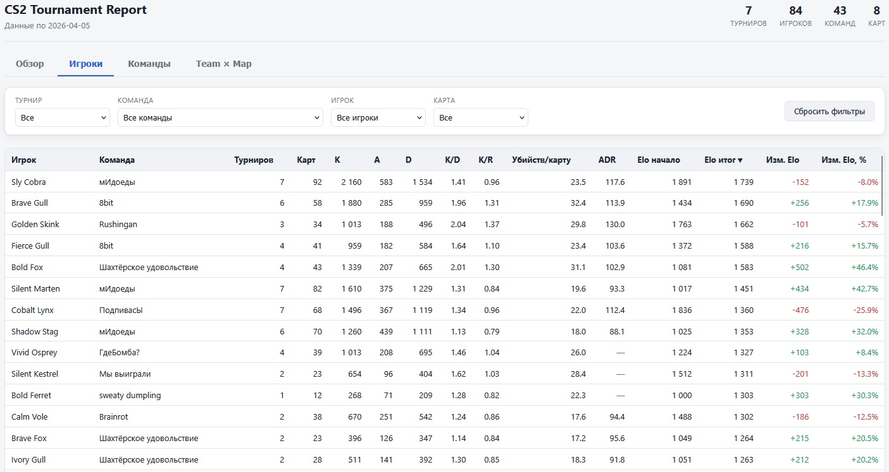
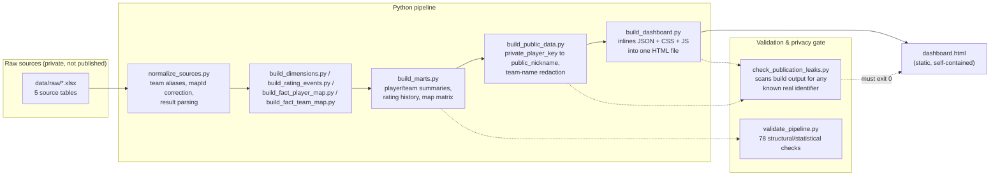

# CS2 Tournament Analytics

Interactive analytics dashboard and reproducible data pipeline for amateur Counter-Strike tournaments.

**Live Dashboard: https://q-stat.ru/reports/cs2-tournament/**

## Overview

This project turns several years of amateur CS2 tournament results into a browsable analytics
report: player and team performance, Elo rating history across a multi-stage rating cycle, and
map-level breakdowns.

Historically, this analysis lived in three disconnected places — a Google Sheets/Excel export, a
couple of one-off Google Colab notebooks re-run by hand for every tournament, and a Power BI
report built on top of them. Formulas existed only as DAX measures and Power Query steps, with no
single documented source of truth and no way to verify a number without opening the report itself.

This repository replaces that with a single reproducible pipeline: plain Python transforms
tabular source data into a versioned set of dimension/fact/mart tables, every non-trivial formula
recovered from the legacy Power BI/notebook logic is cross-checked against the original data (see
`docs/legacy_vs_canonical_results.md`), and the result is published as a static, dependency-free
HTML dashboard — no backend, no database.



*Players tab — every name shown is a randomly generated pseudonym (see [Privacy](#privacy)); team
names are real. More screenshots (Overview, Teams, Team × Map) can be added to `docs/images/` the
same way.*

## Features

- **Tournament overview** — KPI summary across all tournaments (players, teams, maps, last update).
- **Player analytics** — sortable stats table (kills/deaths/ADR/K-D/K-R), per-player map history,
  and Elo progression.
- **Team analytics** — roster history, per-tournament placement, win/loss record, round differential.
- **Elo rating lifecycle** — full multi-stage rating history per player/team (see below), not just
  a single "current rating" number.
- **Calibration vs. final ratings** — explicit comparison between the rating a player/team entered
  a tournament with and the rating it left with.
- **Map analytics** — team × map heatmap with sample-size-aware highlighting (small samples are
  visually de-emphasized rather than hidden).
- **Cascading filters** — tournament → team → player → map filters stay consistent with each other
  across every tab.
- **Privacy-safe publication** — the public dashboard never shows a real player identifier (see
  [Privacy](#privacy) below).

## Rating lifecycle

Each tournament cycle moves a player's/team's Elo rating through up to four stages:

| Code | Stage | Meaning |
|---|---|---|
| **A** | `normalized_entry` | Normalized starting rating going into the tournament (returning players are rescaled so the group total stays proportional; new players start at a fixed baseline). |
| **C** | `calibration_final` | Rating after the calibration games played before the tournament proper. |
| **N** | `blended_normalized` | Rating used to draft/assign permanent teams — a weighted blend of the fresh calibration result and the player's final rating from the previous one or two tournaments. |
| **T** | `tournament_final` | Final rating after the tournament itself. |

The dashboard exposes this as a single continuous timeline per player/team (entry → calibration →
team-forming blend → tournament final) instead of one static number, so you can see how much of a
rating change came from calibration versus the tournament itself.

## Architecture



Full grain/key/lineage documentation: `docs/data_model.md`. Recovered Power Query/DAX logic and
how it compares to the canonical model: `docs/powerbi_logic_audit.md`,
`docs/legacy_vs_canonical_results.md`.

## Data model

- **Dimensions** — `dim_tournament`, `dim_team`, `dim_map`, `dim_rating_stage`,
  `dim_player_public` (pseudonymized).
- **Facts** — `fact_player_rating_event` (one row per rating-cycle event), `fact_player_map`
  (player × map), `fact_team_map` (team × map, directly reconciled against its opponent row).
- **Marts** — `mart_player_summary`, `mart_player_rating_history`, `mart_team_summary`,
  `mart_team_rating_history`, `mart_team_map_matrix`, and a few more — one per dashboard view.

This is a summary, not a full data dictionary; see `docs/data_model.md` for the complete grain,
key, and lineage documentation, and `config/metric_definitions.json` for the exact formula behind
every metric shown on the dashboard.

## Data quality

- **Canonical keys, not source keys.** Several source identifiers (`mapId`, `matchId`) reset per
  tournament rather than being globally unique; the canonical model always keys on
  `(tournament_number, tournament_phase, map_number)` instead.
- **`mapId` normalization.** One source table indexes maps from 0, another from 1; the pipeline
  aligns both to a single 1-based sequence rather than leaving the offset implicit.
- **Rating invariants, checked automatically.** For every tournament, the sum of normalized entry
  ratings equals `player_count × 1000`, and `rating_after == rating_before + rating_change` for
  every rating event — enforced by `validate_pipeline.py` and by `tests/test_marts_integration.py`.
- **Availability-aware ADR/MVP.** ADR and MVP tracking were only enabled for some tournaments;
  players/maps without tracking show "no data" rather than a misleading 0.
- **Automated validation.** `pipeline/validate_pipeline.py` runs 78 structural and statistical
  checks (key uniqueness, reconciliation between a team and its opponent's row, rating invariants,
  roster-size anomalies, dashboard content) on every pipeline run.
- **Automated tests.** `pytest` (68 tests) covers the parsing/normalization logic, rating
  invariants, team classification, and the privacy mechanism itself.
- **Automated privacy leak detection.** `pipeline/check_publication_leaks.py` scans every file in
  a build output directory (by filename and by content) for literal matches against every known
  real player identifier, and fails the build on any match — see [Privacy](#privacy).

None of the above are marketing claims — every one of them is backed by a test or a validation
check you can run yourself (see [Testing](#testing)).

## Privacy

- Real player identifiers (in-game nickname, internal id, Steam/Discord/Faceit account) are
  **never** published. The public dashboard only ever shows a `public_nickname` /
  `public_player_id` pair, randomly generated and stored in a private mapping table that is not
  part of this repository.
- Team names are treated as tournament metadata, not personal data, and are shown as-is — with one
  documented exception: any historical team name that literally embeds a player's private
  identifier as a substring is automatically replaced with a redacted placeholder before
  publication (see `docs/privacy_and_publication.md`, §0, for how this was found and handled).
- The private mapping table, the raw source tables, and every intermediate table keyed by the
  internal player id are excluded from this repository (see `.gitignore`) — the public dashboard
  is built only from the already-pseudonymized `data/public/` layer.
- Before any publication, `pipeline/check_publication_leaks.py` scans the entire build output
  against every known real identifier and blocks the build on any match. This check is also
  enforced by the test suite (`tests/test_privacy.py`) and was additionally run once against the
  full file set intended for this public repository as part of preparing it for publication (see
  `artifacts/publication/github_publication_audit.md`).

## Tech stack

- **Data pipeline:** Python 3.12, [pandas](https://pandas.pydata.org/), `openpyxl` (reading source
  `.xlsx`), [pyarrow](https://arrow.apache.org/docs/python/) (Parquet storage), `Jinja2`
  (dashboard template rendering).
- **Dashboard:** static HTML/CSS, vanilla JavaScript, [Apache ECharts](https://echarts.apache.org/)
  (loaded from CDN, with an offline-friendly fallback — tables and filters keep working without it).
- **Testing:** `pytest`.

## Project structure

```
pipeline/            Python pipeline: normalize -> dimensions/facts -> marts -> public data -> dashboard
  build_*.py            one script per pipeline stage (see Architecture)
  check_publication_leaks.py   privacy leak scanner
  validate_pipeline.py  78 structural/statistical checks
  run_pipeline.ps1      full pipeline runner (PowerShell)

dashboard/            static frontend assets inlined into dashboard.html
  css/styles.css
  js/app.js

dashboard.html        the built, self-contained dashboard (also the live artifact behind the demo link)

data/public/          pseudonymized JSON data — the only data source dashboard.html reads

config/               dashboard config, metric formula definitions
docs/                 architecture, data model, rating semantics, legacy-vs-canonical audit, privacy contract
tests/                pytest suite
artifacts/validation/ output of the last validate_pipeline.py run (validation.md/json)
```

Not included in this repository (see [Privacy](#privacy) and `.gitignore`): raw source tables
(`data/raw/`), the private player-alias mapping (`data/private/`), and the intermediate/canonical
layers keyed by the internal player id (`data/interim/`, `data/processed/`). Internal audit
artifacts built by directly profiling the raw source data are excluded for the same reason.

## Running locally

There are two different things you can run, and it's worth being upfront about which one is
actually reproducible without access to the original private source data.

**1. Dashboard/frontend, from the published data (fully reproducible):**

```
python -m venv .venv
.venv\Scripts\activate      # Windows; use `source .venv/bin/activate` on Linux/macOS
pip install -r requirements.txt

python pipeline/build_dashboard.py
```

This rebuilds `dashboard.html` from the already-pseudonymized `data/public/*.json` shipped in this
repository, plus `config/` and `dashboard/`. No private data is needed for this step. You can also
just open the already-built `dashboard.html` directly in a browser — it's self-contained.

**2. Full data pipeline, from raw source tables (not reproducible from this repository alone):**

The earlier pipeline stages (`normalize_sources.py` through `build_marts.py` and
`build_public_data.py`) require `data/raw/*.xlsx` and `data/private/player_aliases.csv`, which
contain real player data and are intentionally not part of this repository. If you have your own
copy of those files in the expected layout, the full sequence is documented in
`pipeline/run_pipeline.ps1` and can be run end-to-end with:

```
powershell -ExecutionPolicy Bypass -File pipeline/run_pipeline.ps1 -Clean -Open
```

## Testing

```
python -m pytest tests/ -v            # 68 tests
python pipeline/validate_pipeline.py  # 78 structural/statistical checks
python pipeline/check_publication_leaks.py data/public   # privacy leak scan
python pipeline/check_publication_leaks.py dashboard.html
```

All four are run against what's actually in this repository — `data/public/` and `dashboard.html`
are the already-built artifacts checked in here, so the full test/validation/leak-check sequence
above works right after cloning, with no private data required.

## Live demo

**https://q-stat.ru/reports/cs2-tournament/**

## Background

This project grew out of the analytics for a recurring series of amateur CS2 tournaments, whose
reporting had accumulated over time across a spreadsheet, a couple of manually re-run notebooks,
and a Power BI report — each with its own partial view of the rating logic and no single source
of truth. Recovering and cross-checking that logic against the original data (see
`docs/source_audit.md`, `docs/powerbi_logic_audit.md`) turned out to be most of the actual work;
the static dashboard is the last step, not the first.
