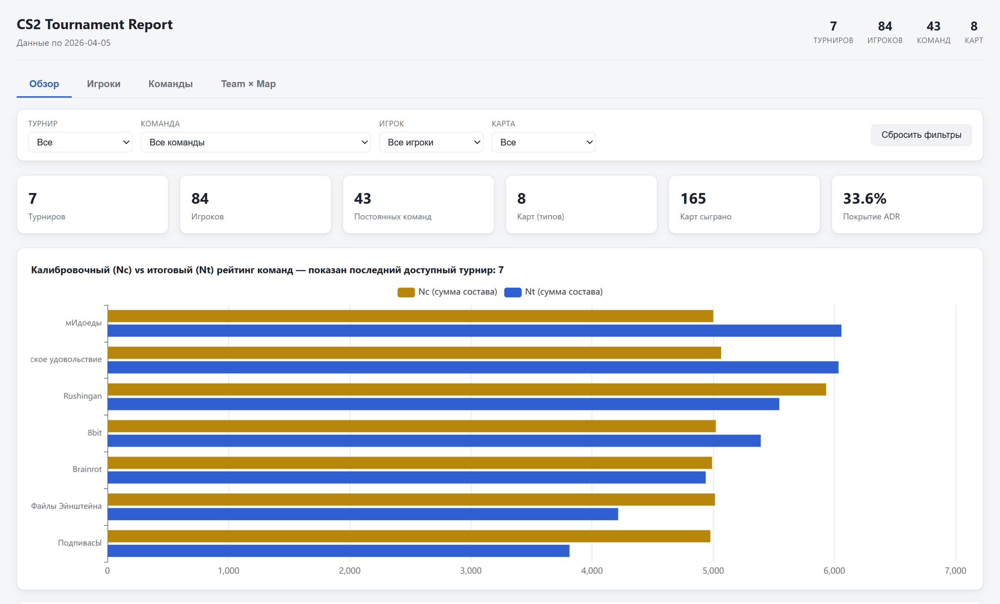
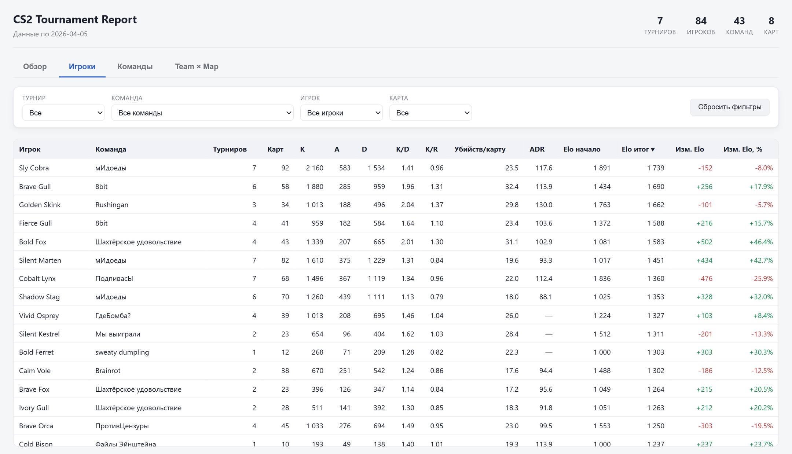
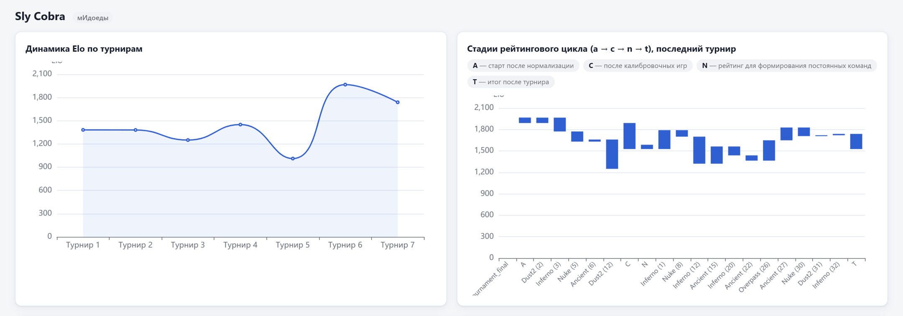
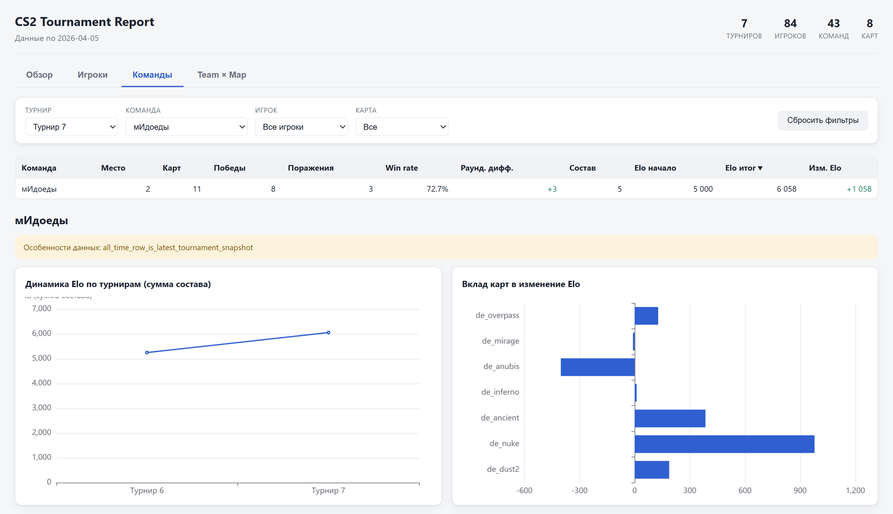
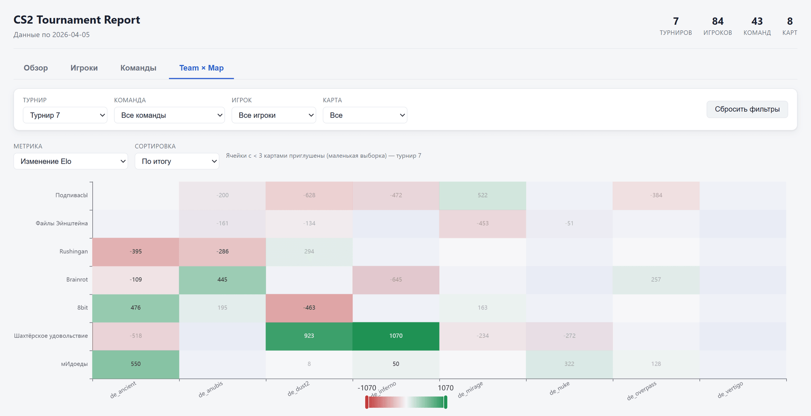
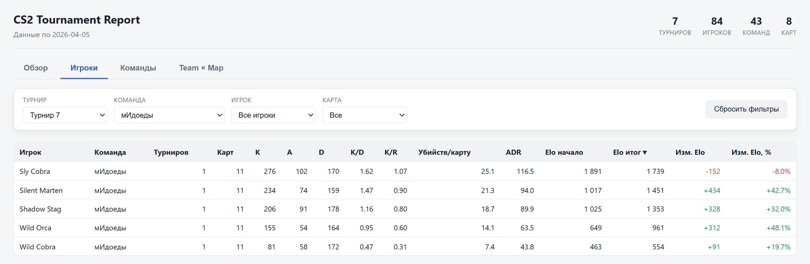
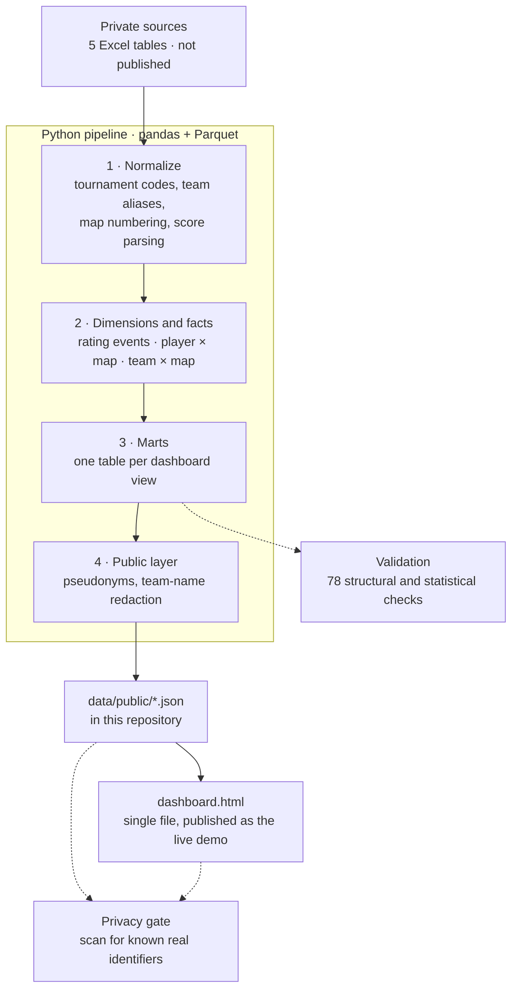

# CS2 Tournament Analytics

**From fragmented Excel, Colab and Power BI reporting to a reproducible analytics pipeline: a canonical data model, documented metric definitions, automated data-quality checks and a public, pseudonymized dashboard.**

[](https://q-stat.ru/reports/cs2-tournament/)

**Live dashboard:** [q-stat.ru/reports/cs2-tournament](https://q-stat.ru/reports/cs2-tournament/) (interface in Russian, as its audience is local) · **Data model:** [docs/data_model.md](docs/data_model.md) · **Legacy vs. canonical:** [docs/legacy_vs_canonical_results.md](docs/legacy_vs_canonical_results.md)

I designed the rating methodology and built the analytics for a series of amateur Counter-Strike 2 tournaments held from 2022 to 2026: seven tournaments, 84 players, 43 permanent teams, 224 played maps. The first version was a spreadsheet, two hand-run notebooks and a Power BI file, and a number in it could not be checked without opening the report. This repository is my rebuild of that system as one Python pipeline whose every stage can be inspected: source normalization, dimension/fact/mart tables in Parquet, metric formulas in a versioned config, validation checks, a privacy gate, and a single-file HTML dashboard.

The subject is esports. The work is analytics engineering applied to a system of my own: designing a rating methodology, then auditing my earlier BI implementation of it, choosing grains and keys, proving that the new numbers are right, and publishing them without exposing the people behind them.

## Key results

| | |
|---|---|
| **Reproducible pipeline** | Eight Python stages turn five source tables into 5 dimensions, 3 fact tables and 8 marts. The published dashboard rebuilds byte-for-byte from the public data in this repository |
| **Canonical data model** | Explicit grain and key for every table; composite keys replace source ids that reset per tournament |
| **Own legacy logic audited** | Every Power Query step and DAX measure of my earlier Power BI report was traced to its source. Of six audited measure groups, three matched the legacy numbers exactly and three were deliberately replaced because the legacy formula was provably wrong ([details](#legacy-reconciliation)) |
| **Custom rating methodology** | A multi-stage, Elo-style rating that I designed and tuned over seven tournaments, 2022 to 2026 ([details](#the-rating-methodology)) |
| **Rating modelled as events** | More than 3,000 rating events across a four-stage cycle, instead of one "current rating" column per player |
| **Automated checks** | 78 structural and statistical validation checks (0 critical failures, 1 documented warning on the last full run) and 68 pytest tests |
| **Pseudonymized publication** | Players appear only under random pseudonyms; a leak scanner blocks the build if a known real identifier reaches the output |

Numbers that need the private source data to reproduce are marked as such in [Reproducibility](#reproducibility).

## Dashboard preview

<table>
  <tr>
    <td width="50%"><br><sub><b>Players.</b> Sortable statistics. A dash in the ADR column means "not tracked", not zero.</sub></td>
    <td width="50%"><br><sub><b>Rating history.</b> Rating across tournaments, and every step of the last cycle (A → C → N → T) map by map.</sub></td>
  </tr>
  <tr>
    <td width="50%"><br><sub><b>Teams.</b> Placement, record, round differential, roster rating and the contribution of each map.</sub></td>
    <td width="50%"><br><sub><b>Team × Map.</b> Heatmap with four metrics. Cells with fewer than three maps are muted, not hidden.</sub></td>
  </tr>
</table>



<sub><b>Cascading filters.</b> Choosing a tournament and a team narrows every tab to that context; here the players table shows one roster with statistics recomputed for that tournament only.</sub>

All screenshots were taken from the production site on 22 November 2026 and are cropped but not edited. Player names in them are the generated pseudonyms; team names are real.

## How the project evolved

This is one system, built by one person over several years (the tournaments ran from 2022 to 2026), in three steps:

1. **Methodology and data.** I designed the rating rules for the tournaments and kept the source tables in Google Sheets.
2. **First analytics system.** I wrote the Google Colab notebooks that compute the rating and built the Power BI report on top of them, with the joins in Power Query and the metrics in DAX. The methodology was adjusted between tournaments as results came in. All of this was done by hand, without AI tools.
3. **Modernization.** I rebuilt the system as the pipeline in this repository: a canonical data model, metric definitions outside the report, automated validation and a standalone dashboard. This step was carried out with AI coding tools under my direction and review.

The modernization was a review of my own earlier work, not a port of someone else's. Writing down grains, keys and formulas exposed limitations in the first implementation, including two measures that returned wrong numbers across tournaments and one that depended on an unstated assumption. They are documented [below](#legacy-reconciliation), not hidden: finding them was the point of the rebuild.

## The problem

The first system had grown in three disconnected places:

- **Google Sheets / Excel** held five source tables: per-map results, rating changes, rating normalization, team placement and a wide player sheet.
- **Two Google Colab notebooks** computed the rating. They were re-run by hand for each tournament, one for calibration games and one for the main event.
- **A Power BI report** joined everything in Power Query and defined the metrics as DAX measures.

That arrangement worked while one person ran it for a handful of tournaments. Looked at critically, it had specific defects:

- Metric definitions existed only inside DAX and Power Query. There was no written definition to check a number against.
- Source identifiers were ambiguous. `mapId` and `matchId` restart in every tournament, and two tables numbered maps from different bases (0 and 1).
- Tournament codes such as `8a`, `8c`, `8n`, `8t` are four stages of one rating cycle, but the model treated them as opaque labels.
- "Not collected" and "zero" were stored the same way, so averages silently included tournaments where a statistic was never tracked.
- Nothing reconciled the report against the source data.

## The solution

One pipeline, run with one command, in which each stage reads the output of the previous one and nothing is computed inside the presentation layer:

1. **Normalize** the five source tables: parse tournament codes into `tournament_number` and `rating_stage`, resolve team-name aliases through a reviewed mapping, align map numbering, and parse scores without guessing.
2. **Build dimensions and facts** with declared grains and composite keys.
3. **Build marts**, one per dashboard view, using the formulas in [`config/metric_definitions.json`](config/metric_definitions.json).
4. **Validate** the result: key uniqueness, two-sided reconciliation of every map, rating invariants, availability rules.
5. **Publish** a pseudonymized JSON layer, then scan it for known real identifiers.
6. **Render** the dashboard as one HTML file with data, styles and code inlined.

## Architecture



Everything above `data/public/*.json` needs the private source tables. Everything below it runs from this repository alone.

## Data model and metrics

| Layer | Tables | Grain |
|---|---|---|
| **Dimensions** | `dim_tournament`, `dim_team`, `dim_map`, `dim_rating_stage`, `dim_player_public` | one row per tournament, team, map, rating stage, player |
| **Facts** | `fact_player_rating_event` | one rating event of one player (3,105 rows in the published history) |
| | `fact_player_map` | one player on one played map (2,235 rows) |
| | `fact_team_map` | one team on one played map (448 rows, two per map) |
| **Marts** | `mart_player_summary`, `mart_player_rating_history`, `mart_player_map`, `mart_team_summary`, `mart_team_rating_comparison`, `mart_team_rating_history`, `mart_team_map`, `mart_team_map_matrix` | one per dashboard view |

The player dimension exists twice. `dim_player_private` carries the real identifiers and never leaves the private layer. `dim_player_public` holds only a pseudonym and an opaque id.

### The rating methodology

The tournaments use a rating that I designed for them. It is called Elo in the community, but it is not the classic pairwise Elo formula: after each map, the combined rating of the players on that map is redistributed in proportion to a performance score built from kills, assists, MVPs and ADR, in three passes with decreasing weights. Each tournament moves a player through up to four stages:

| Code | Stage | Meaning |
|---|---|---|
| **A** | `normalized_entry` | Starting rating, rescaled so that the field sums to `players × 1000`; new players start at a fixed baseline |
| **C** | `calibration_final` | Rating after the calibration games played before the tournament |
| **N** | `blended_normalized` | Blend of the fresh calibration result and previous tournament finals, used to form permanent teams |
| **T** | `tournament_final` | Rating after the tournament itself |

**What the rating is for.** Its job is to form balanced teams from players of very different skill, and to carry what is known about a player from one tournament to the next. That purpose explains the stages:

- **A** rescales returning players so that every tournament starts from the same average of 1000, whoever turns up.
- **C** measures current form in calibration games. Teams for each calibration game are balanced by exhaustive search over all 5-versus-5 splits of the ten players, minimising the difference in total rating.
- **N** tempers a short calibration run with history. It blends the calibration result with the finals of the last two tournaments, weighting the more recent one higher, and is then normalized again. Permanent teams are drafted from it, with a target team strength of about 5000.
- **T** records what the tournament itself changed.

**How it was developed.** I worked the rules out iteratively: I set the formulas and weights, checked how they behaved on the tournaments already played, applied them to the next tournament and adjusted them in the light of the results. Traces of that are visible in the data and are documented, not smoothed over:

- The performance score is `3 × kills + assists + 5 × MVPs + 0.2 × ADR`. MVP counts were recorded only in tournaments 1 to 3 and ADR only from tournament 6, so the inputs available to the score changed over the series.
- The blended **N** stage exists only for tournament 7, the latest cycle.
- The entry-normalization rule reproduces the stored ratings with a mean error of about 100 points per player in tournament 2 and 0.3 points in tournament 7, while the field total equals `players × 1000` in all seven. The procedure became more systematic as the series went on.

This was judgement-driven tuning on a small dataset. No formal optimisation, statistical validation or predictive model is claimed, and the parameter values of earlier iterations are not part of this repository. The formulas as they stand, and what could and could not be confirmed against the notebooks and the data, are in [docs/rating_semantics.md](docs/rating_semantics.md).

**Metrics.** Kills, assists, deaths, K/D, K/R, kills per map, ADR and MVP with coverage, win rate, round differential, rating start, final and change. Each has an entry in [`config/metric_definitions.json`](config/metric_definitions.json) with numerator, denominator, grain, availability rule and its legacy equivalent. The reasoning is in [docs/metric_catalog.md](docs/metric_catalog.md) and [docs/rating_semantics.md](docs/rating_semantics.md).

## Engineering highlights

Five decisions that shaped the model. Each one came out of a limitation I found in my own earlier implementation.

### 1. Canonical keys instead of source ids

- **Problem.** `mapId` runs 1–32 and restarts in every tournament. The legacy measure `DIVIDE(SUM(kills), DISTINCTCOUNT(mapId))` therefore counted 32 distinct values where there were 224 maps, as soon as a filter spanned more than one tournament. A second table numbered the same maps from 0.
- **Decision.** Every fact is keyed on `(tournament_number, tournament_phase, map_number)`. The 0-based table is shifted by one during normalization, as an explicit, named correction.
- **Verification.** After the shift, 99.96 % of result rows join to a rating change; the single unmatched row is documented. Validation checks fact-grain uniqueness and that every map has exactly two teams.
- **Benefit.** Across all tournaments the figure is 163.98 kills per map (all players on the map), not the 1,147.84 the legacy measure reported. The overstatement affected 64 of 84 players.

### 2. Rating as a sequence of events

- **Problem.** The source kept three rating columns per player per tournament. The legacy `EloFinal` measure was correct only if the user remembered to filter by stage; without the filter, calibration and tournament changes were summed together, an error of up to 780 points for one player.
- **Decision.** `fact_player_rating_event` stores one row per event with `rating_before`, `rating_change`, `rating_after`, a mandatory `rating_stage` and the version of the formula that produced it.
- **Verification.** `rating_after = rating_before + rating_change` holds for all 2,875 events where the three values are present. Entry ratings sum to `players × 1000` in each of the seven tournaments. Calibration rating plus tournament changes reproduces the source final for all 229 player-tournament pairs. In tournament 7, 35 stage finals differ from a map-by-map reconstruction; they are flagged and explained in the rating document, not adjusted.
- **Benefit.** The dashboard can show how much of a rating change came from calibration and how much from the tournament, map by map. Mixing stages by accident is no longer possible without ignoring a key column.

### 3. Metric definitions recovered from DAX and Power Query

- **Problem.** The only definition of a metric was its DAX expression, and some measures were duplicated or relied on unstated assumptions: a fixed roster of five, a text field sorted as if it were a number.
- **Decision.** Each M query and DAX measure was traced from source to visual, then rewritten as a declarative entry in `metric_definitions.json` with its grain and availability rule. Where the legacy formula was wrong, the canonical one replaces it and the difference is written down.
- **Verification.** See the [reconciliation table](#legacy-reconciliation). Plain counters were compared directly with sums over the source table.
- **Benefit.** A number on the dashboard can be traced to a formula, a table and a source column. The lineage of one metric is written out end to end in [docs/data_model.md](docs/data_model.md).

### 4. Missing is not zero

- **Problem.** ADR was collected for only 750 of 2,235 player-map rows; the rest were stored as 0. The legacy `AVERAGE(adr)` therefore returned 26.3 where the average over tracked maps is 78.5.
- **Decision.** `adr_tracked` and `mvp_tracked` flags are set per tournament and stage. Untracked values are null, averages use tracked rows only, and a coverage share is carried alongside.
- **Verification.** Validation asserts that no untracked row carries a value and that tracking is consistent within each tournament and stage. A score cell that Excel had converted to a date is kept raw and marked unparseable instead of being "recovered".
- **Benefit.** 35 of 84 players have no tracked ADR at all. The dashboard shows them a dash, not a zero that would rank them last.

### 5. A privacy gate in the build

- **Problem.** The source data holds real names, cities, departments and Steam, Discord and Faceit accounts. A public dashboard had to keep the statistics real and the people unidentified by name or account.
- **Decision.** Pseudonyms are random, not hashes: with fewer than a hundred known ids, a truncated hash could be reversed by enumeration. The mapping lives in a private table. A scanner collects every known real identifier and searches the build output, file names included.
- **Verification.** On its first run the scanner found a real case: a historical team named after one of its players. That name is now replaced by a placeholder at export, 1 team of 69. The scanner has a self-test and is covered by the test suite.
- **Benefit.** Publication fails closed on a known identifier. The limits of this guarantee are stated [below](#data-quality-and-privacy).

### Legacy reconciliation

| Measure | Legacy vs. canonical | Outcome |
|---|---|---|
| Kills, deaths, assists, K/D, K/R | Identical | Kept as is |
| `EloFinal` | Identical for all 229 player-tournament pairs when the stage filter is applied | Kept; the stage is now a mandatory column |
| `startElo` | Identical on current data; the legacy text sort would break at tournament 10 | Kept; sorting uses a numeric tournament number |
| `avgKills` | Legacy overstates about sevenfold across tournaments | Replaced: composite-key denominator |
| `avgADR` | Legacy understates about threefold | Replaced: tracked maps only, with coverage |
| `TeamsPP` (round differential) | Legacy divides by a fixed 5 players. Five team-maps have 4 players, but their scores are unparseable, so no numeric difference shows in the data | Replaced on structural grounds: computed directly at team × map grain |

"Legacy" here means my own earlier Power BI report. This is not a claim of full equivalence with it. Three groups were verified equal, three were changed on purpose, and the evidence for each is in [docs/legacy_vs_canonical_results.md](docs/legacy_vs_canonical_results.md).

## Data quality and privacy

**Validation.** `pipeline/validate_pipeline.py` runs 78 checks against the built tables: source-file integrity, dimension and fact key uniqueness, two-sided reconciliation of all 224 maps (opposite results, mirrored round differential, mutual opponent), rating invariants, availability rules, team classification, and the content of the public layer. The last full run is stored in [artifacts/validation/validation.md](artifacts/validation/validation.md): 0 critical failures and 1 warning, a single row with a negative kill count that is kept as found and flagged.

**Tests.** 68 pytest tests cover the parsers, key construction, rating invariants, duplicate detection, team classification, roster anomalies, pseudonym generation, the leak scanner, and the dashboard's behaviour, which runs under Node against a minimal DOM shim with 33 assertions.

**What the privacy mechanism does**

- Real player identifiers are replaced before export by a random pseudonym and an opaque id. The mapping table, the source tables, and every intermediate table keyed by the internal player id are excluded from this repository.
- Team names are treated as tournament metadata and published as they are, except any name that contains a player identifier as a substring.
- `pipeline/check_publication_leaks.py` searches the build output for literal, case-insensitive matches against every known real identifier and exits non-zero on a match.

**What it does not do**

- The scanner knows only the identifiers present in the private source tables. It does not detect transliterations, misspellings, or text inside images.
- Without the private tables its token list is empty and the scan checks nothing. In a clone of this repository it says so and the related tests are skipped.
- Pseudonymization is not anonymity. The statistics are real, team names are real, and rosters are visible, so someone who took part in these tournaments could recognise a player from results and teammates. The mechanism prevents publishing names and accounts; it does not prevent that kind of inference.

The full contract is in [docs/privacy_and_publication.md](docs/privacy_and_publication.md); the review carried out before the repository was opened is in [artifacts/publication/github_publication_audit.md](artifacts/publication/github_publication_audit.md).

## Technology stack

| Area | Tools |
|---|---|
| **Pipeline** | Python 3.12, pandas, pyarrow (Parquet), openpyxl (source `.xlsx`), Jinja2 (dashboard template), PowerShell runner |
| **Earlier system (also mine), audited here** | Power BI: DAX measures ([dax.txt](dax.txt)) and Power Query M ([powerquery.txt](powerquery.txt)); Google Sheets; Google Colab notebooks |
| **Dashboard** | Static HTML and CSS, vanilla JavaScript, Apache ECharts 5.5.1 |
| **Testing** | pytest; Node.js for the dashboard behaviour check |

## Reproducibility

| | From this repository alone | Needs the private source data |
|---|---|---|
| Open `dashboard.html` or rebuild it from `data/public/` | Yes. The rebuild is byte-identical to the committed file and to the live site | |
| Dashboard behaviour test | Yes, with Node.js | |
| `pytest` | 27 tests run and pass; 41 are skipped | All 68 run |
| `validate_pipeline.py` (78 checks) | No. It reads the Parquet layer, which is not published; the stored report shows the last run | Yes |
| Leak scan | Runs, but as a no-op with a warning | Yes, against the real identifier list |
| Full pipeline from source tables | No | Yes |

**Rebuild the dashboard from public data**

```
python -m venv .venv
.venv\Scripts\activate          # Windows; on Linux/macOS: source .venv/bin/activate
pip install -r requirements.txt

python pipeline/build_dashboard.py
python -m pytest tests/ -v      # 27 passed, 41 skipped without private data
```

**Run the full pipeline.** This needs `data/raw/*.xlsx` and `data/private/player_aliases.csv` in the expected layout. The sequence is in [`pipeline/run_pipeline.ps1`](pipeline/run_pipeline.ps1):

```
powershell -ExecutionPolicy Bypass -File pipeline/run_pipeline.ps1 -Clean -Open
python -m pytest tests/ -v                               # 68 tests
python pipeline/validate_pipeline.py                     # 78 checks
python pipeline/check_publication_leaks.py data/public
python pipeline/check_publication_leaks.py dashboard.html
```

The figures of 68 passing tests and 78 checks come from the last full run with private data, recorded in the publication audit of 9 August 2026. They were not re-run for this revision of the README, which was prepared from a clone without the private data.

## Known limitations

- **One external resource.** `dashboard.html` inlines its data (about 3.6 MB of JSON), styles and code, and needs no backend or database. The ECharts library is loaded from the jsDelivr CDN. Without network access the KPI tiles, tables, filters and profiles still work, and each of the seven charts shows a "chart unavailable" notice. To run fully offline, download `echarts.min.js` once and point the script tag in `pipeline/dashboard_template.html` at the local copy.
- **Not a live system.** The dashboard is a static build with data up to April 2026. There is no scheduler and no incremental load.
- **Small data.** A few thousand rows. The project demonstrates modelling and verification, not scale.
- **Descriptive analytics only.** No forecasting, no experiments, no causal claims.
- **Language.** The dashboard interface, the code comments and the detailed documents under `docs/` are in Russian.
- **Open questions.** Assumptions that could not be confirmed from the data are listed in [docs/unresolved_questions.md](docs/unresolved_questions.md), not resolved by guesswork.

## My role

This is a multi-year project. Between 2022 and 2026 I independently designed and developed the entire analytics system, from the original spreadsheets and Google Colab notebooks to the Power BI report and the current Python pipeline.

I also developed the custom multi-stage, Elo-style rating methodology, tuning it iteratively against historical tournament data and evaluating its behaviour as new tournaments were played.

The original system, including the rating methodology, the notebooks and the Power BI report, was built without AI assistance. The later modernization introduced the canonical data model, reproducible calculations, automated validation and the standalone interactive dashboard; for that step I used AI coding tools, setting the requirements, supplying the authoritative business rules and reviewing the results.

## Documentation

| Document | Contents |
|---|---|
| [docs/data_model.md](docs/data_model.md) | Grain, keys and lineage of every table |
| [docs/metric_catalog.md](docs/metric_catalog.md) | Every metric: definition, formula, availability |
| [docs/rating_semantics.md](docs/rating_semantics.md) | The four-stage rating cycle and its formulas |
| [docs/powerbi_logic_audit.md](docs/powerbi_logic_audit.md) | Each Power Query step and DAX measure, traced and assessed |
| [docs/legacy_vs_canonical_results.md](docs/legacy_vs_canonical_results.md) | Numeric comparison of legacy and canonical formulas |
| [docs/source_audit.md](docs/source_audit.md), [docs/source_audit_v2.md](docs/source_audit_v2.md) | Profile of the source tables and the notebooks |
| [docs/privacy_and_publication.md](docs/privacy_and_publication.md) | Privacy contract and the leak scanner |
| [docs/dashboard_spec.md](docs/dashboard_spec.md) | Dashboard views, filters and behaviour |
| [docs/unresolved_questions.md](docs/unresolved_questions.md) | Open questions and unconfirmed assumptions |

## Project structure

```
pipeline/             Python pipeline, one script per stage
  normalize_sources.py, build_dimensions.py, build_rating_events.py,
  build_fact_player_map.py, build_fact_team_map.py, build_marts.py,
  build_public_data.py, build_dashboard.py
  validate_pipeline.py          78 validation checks
  check_publication_leaks.py    privacy leak scanner
  run_pipeline.ps1              full pipeline runner
dashboard/            CSS and JavaScript inlined into dashboard.html
dashboard.html        the built dashboard, identical to the live site
data/public/          pseudonymized JSON, the only data the dashboard reads
config/               metric definitions, dashboard configuration
docs/                 data model, metrics, rating semantics, audits, privacy contract
tests/                pytest suite and the Node-based dashboard check
artifacts/            stored validation report, pre-publication audit
dax.txt, powerquery.txt   the legacy Power BI logic that was audited
```

Not in this repository: the source tables (`data/raw/`), the pseudonym mapping (`data/private/`), the intermediate and canonical Parquet layers (`data/interim/`, `data/processed/`), the original notebooks, and audit artifacts built by profiling the source data.
